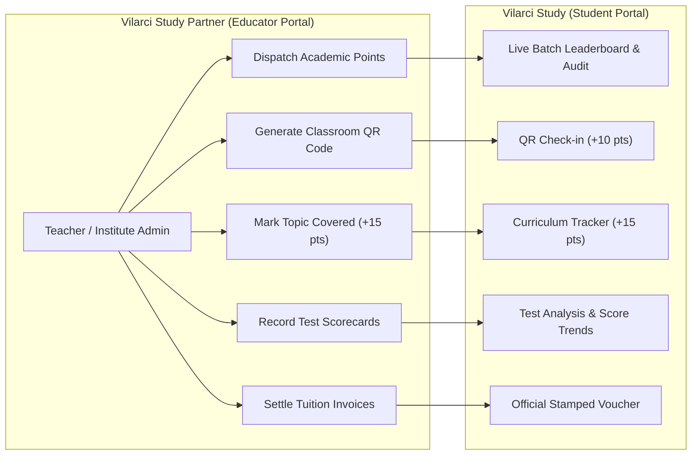
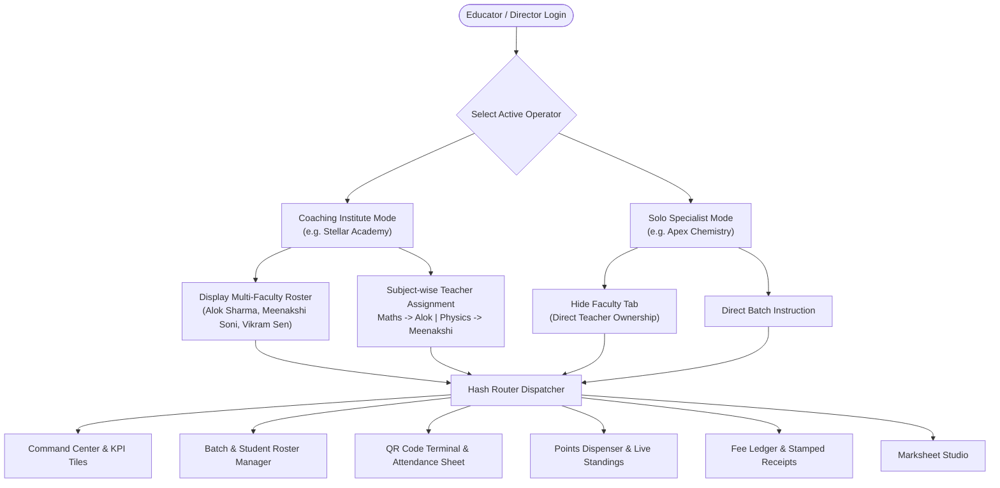
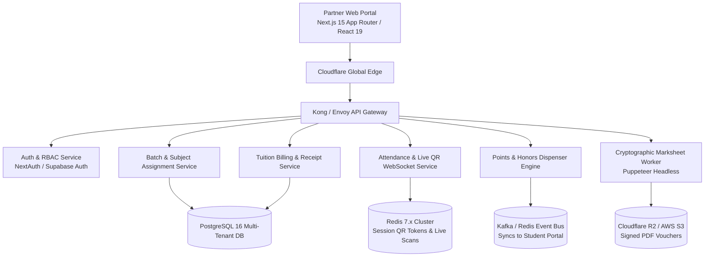
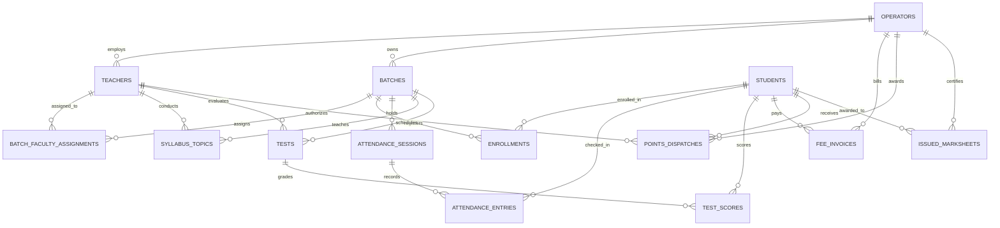

# Vilarci Study Partner — Teacher & Coaching Institute Portal
## Complete System Architecture, Technology Pipeline & Database Design Document

**Document Identifier**: `vilarci-study-partner-website-pipeline.md`  
**Application**: Vilarci Study Partner (v2.0 Regal Maroon Edition)  
**Target Repository**: `Krishnendu-Kar/vilarci-study-partner-website`  
**Date of Architecture Specification**: October 2026  
**Status**: Production Architectural Blueprint & Prototype Reference  

---

## Table of Contents
1. [Executive Summary & Product Vision ("What Was Wanted")](#1-executive-summary--product-vision-what-was-wanted)
   - [1.1 The Partner Portal Role in the Vilarci Ecosystem](#11-the-partner-portal-role-in-the-vilarci-ecosystem)
   - [1.2 Dual Operator Hierarchy: Solo Teachers vs Multi-Faculty Coaching Institutes](#12-dual-operator-hierarchy-solo-teachers-vs-multi-faculty-coaching-institutes)
   - [1.3 Subject-Wise Teacher Assignment to Batches](#13-subject-wise-teacher-assignment-to-batches)
   - [1.4 Live Classroom QR Attendance Terminal](#14-live-classroom-qr-attendance-terminal)
   - [1.5 Points & Academic Honors Dispenser Desk](#15-points--academic-honors-dispenser-desk)
   - [1.6 Assessments, Test Marks & Diagnostic Analytics](#16-assessments-test-marks--diagnostic-analytics)
   - [1.7 Tuition Fee Ledger & Official Stamped Receipts](#17-tuition-fee-ledger--official-stamped-receipts)
   - [1.8 Academic Marksheets & Credential Issuance Studio](#18-academic-marksheets--credential-issuance-studio)
   - [1.9 Student Admissions & 6-Character Join Codes](#19-student-admissions--6-character-join-codes)
2. [Current Technology Stack & Prototype Implementation ("What Tech Has Used")](#2-current-technology-stack--prototype-implementation-what-tech-has-used)
   - [2.1 Zero-Dependency Vanilla Web Architecture](#21-zero-dependency-vanilla-architecture)
   - [2.2 Design Token System & CSS Architecture](#22-design-token-system--css-architecture)
   - [2.3 Client-Side SPA Hash Router (11 Operational Views)](#23-client-side-spa-hash-router-11-operational-views)
   - [2.4 Relational In-Memory Mock Store](#24-relational-in-memory-mock-store)
   - [2.5 Dynamic SVG Classroom QR Terminal](#25-dynamic-svg-classroom-qr-terminal)
   - [2.6 Print Stylesheet Engine for Stamped Vouchers & Marksheets](#26-print-stylesheet-engine-for-stamped-vouchers--marksheets)
3. [Runtime Architecture & Cross-Portal Integration ("How The Architecture Is Working")](#3-runtime-architecture--cross-portal-integration-how-the-architecture-is-working)
   - [3.1 Operator Hierarchy & Component Flow Diagram](#31-operator-hierarchy--component-flow-diagram)
   - [3.2 Cross-Portal Integration: Partner to Student Synchronization](#32-cross-portal-integration-partner-to-student-synchronization)
   - [3.3 Subject-Wise Teacher-to-Batch Mapping Logic](#33-subject-wise-teacher-to-batch-mapping-logic)
   - [3.4 Directory Structure](#34-directory-structure)
4. [Future Cloud & Enterprise Architecture ("How Future Architect Should Work")](#4-future-cloud--enterprise-architecture-how-future-architect-should-work)
   - [4.1 Enterprise Target Stack (Next.js 15, TypeScript, NestJS/Go)](#41-enterprise-target-stack-nextjs-15-typescript-nestjsgo)
   - [4.2 Microservices & Serverless Component Architecture](#42-microservices--serverless-component-architecture)
   - [4.3 Role-Based Access Control (RBAC) & Faculty Authorization](#43-role-based-access-control-rbac--faculty-authorization)
   - [4.4 Real-Time WebSocket Attendance & Leaderboard Stream](#44-real-time-websocket-attendance--leaderboard-stream)
   - [4.5 Cryptographic Document Generation Engine](#45-cryptographic-document-generation-engine)
5. [Production Database Design ("How DB Should Be Designed")](#5-production-database-design-how-db-should-be-designed)
   - [5.1 Entity-Relationship (ER) Architecture Diagram](#51-entity-relationship-er-architecture-diagram)
   - [5.2 Complete PostgreSQL 3NF Relational Schemas (DDL)](#52-complete-postgresql-3nf-relational-schemas-ddl)
   - [5.3 Row-Level Security (RLS) Policies](#53-row-level-security-rls-policies)
   - [5.4 Redis In-Memory Leaderboard & Attendance Design](#54-redis-in-memory-leaderboard--attendance-design)
6. [Deployment, DevOps & CI/CD Pipeline ("Partner Pipeline")](#6-deployment-devops--cicd-pipeline-partner-pipeline)
   - [6.1 Dual-Account GitHub Configuration](#61-dual-account-github-configuration)
   - [6.2 Automated GitHub Actions Workflow](#62-automated-github-actions-workflow)
   - [6.3 Security, Data Privacy & DPDP Act 2023 Compliance](#63-security-data-privacy--dpdp-act-2023-compliance)

---

## 1. Executive Summary & Product Vision ("What Was Wanted")

### 1.1 The Partner Portal Role in the Vilarci Ecosystem
The **Vilarci Study Partner** portal is the administrative and academic cockpit for educators, tuition masters, and coaching institutes. It is the operational mirror to the **Vilarci Study Student Portal**:
- Where students *view* their timetable, attendance, points, test marks, and fee dues, **educators in Vilarci Study Partner *create, conduct, evaluate, and dispatch* them**.
- Changes made by a teacher in the Partner portal reflect in real time on the enrolled students' dashboards.



---

### 1.2 Dual Operator Hierarchy: Solo Teachers vs Multi-Faculty Coaching Institutes
A central requirement is accommodating two fundamentally different organizational structures:

#### A. Coaching Institute Mode (Multi-Teacher Organization)
- Example: **Stellar Academy** (Director: *Er. Alok Sharma*)
- Characteristics:
  - Employs multiple specialized faculty members (e.g., Er. Alok Sharma for Mathematics, Dr. Meenakshi Soni for Physics, Prof. Vikramaditya Sen for STEM Labs).
  - Offers multiple classroom batches across grades (Class 9, 10, 12).
  - Batches feature **subject-wise teacher assignments**: multiple educators teach distinct subjects inside the same batch.
  - Features an administrative **Faculty Roster** directory to manage teachers' teaching loads, contact info, and qualifications.

#### B. Independent Tuition Teacher Mode (Solo Specialist)
- Examples: **Apex Chemistry** (*Dr. Rashmi Verma*), **Zenith Biology** (*Prof. Arindam Sen*), **Horizon English Studio** (*Mrs. Kavita Roy*).
- Characteristics:
  - Solo educators who directly own and instruct their batches.
  - Streamlined interface: The multi-teacher "Faculty Roster" is hidden; the educator interacts directly with their batches, attendance sheets, and student rosters without bureaucratic layers.

---

### 1.3 Subject-Wise Teacher Assignment to Batches
In secondary and senior-secondary coaching (Classes 9–12), a single batch is rarely taught by one teacher.
- **The Requirement**: Inside a batch like *Class 10 Science & Maths Morning*, the portal explicitly attributes:
  - **Mathematics**: Er. Alok Sharma (3 lectures/week)
  - **Physics**: Dr. Meenakshi Soni (3 lectures/week)
  - **STEM Laboratory & Practicals**: Prof. Vikramaditya Sen (1 lab/week)
- Students and parents know precisely which faculty member teaches each subject, conducts tests, and awards honors.

---

### 1.4 Live Classroom QR Attendance Terminal
- **The Challenge**: Traditional paper roll-call wastes 10–15 minutes of every 90-minute lecture.
- **The Solution**: An integrated **Live Classroom QR Terminal**:
  - The teacher projects today's rotating QR code on the classroom monitor, smartboard, or tablet.
  - Students scan with their Vilarci Study mobile portal, instantly verifying attendance and claiming **+10 learning points**.
  - Includes a fallback **Rapid Attendance Grid** allowing teachers to toggle `Present (P)`, `Absent (A)`, `Late (L)`, or click `Mark All Present` with one click, automatically calculating attendance percentages and sending parent SMS/WhatsApp notices.

---

### 1.5 Points & Academic Honors Dispenser Desk
- Teachers and coaching institutes are the **sole authorized authorities** granting faculty points to students.
- **The Dispenser Desk Workflow**:
  1. Select Batch (e.g. *Class 10 Science & Maths Morning*).
  2. Select Student (e.g. *Aryan Mehta*).
  3. Choose Point Amount (+50, +100, +150, +200, or custom).
  4. Select Category (`Test Excellence`, `Concept Mastery`, `Homework Streak`, `Classroom Leadership`).
  5. Enter Teacher Citation Note.
  6. **Instant Impact**: Upon dispatch, the **Batch Point Leaderboard** preview immediately re-ranks the students, recalculating the motivational gap (e.g., *"Aryan Mehta climbed to Rank #2!"*).

---

### 1.6 Assessments, Test Marks & Diagnostic Analytics
- Teachers schedule tests with custom maximum marks and subject scopes.
- Scorecard entry table records student marks, calculates batch average and highest score, identifies weak topics (e.g., *Trigonometric Identities*, *Ray Optics*), and dispenses bonus practice points (+30 pts to students scoring >80%).

---

### 1.7 Tuition Fee Ledger & Official Stamped Receipts
- Complete tuition billing engine:
  - Track monthly tuition dues per student and per batch.
  - Status filters: `Paid`, `Pending`, `Overdue`.
  - "Record Offline Payment" modal for cash, UPI, or direct bank transfers.
  - "Generate Stamped Receipt" modal with institute letterhead, seal, director signature, and verification hash, ready for in-browser printing.

---

### 1.8 Academic Marksheets & Credential Issuance Studio
- Directorial studio for issuing term report cards and achievement certificates.
- Includes subject-wise marks breakdown, overall percentage, board grade (e.g. `A1`), director signature, and SHA-256 cryptographic verification reference.

---

### 1.9 Student Admissions & 6-Character Join Codes
- Each coaching center and solo teacher possesses a unique 6-character invite code (e.g., `STLR10`, `APEX99`, `ZEN77`, `HORIZ5`).
- The portal includes one-click clipboard copying, WhatsApp broadcast sharing, and parent contact verification links (Father, Mother, Guardian verified mobile numbers).

---

## 2. Current Technology Stack & Prototype Implementation ("What Tech Has Used")

```
┌────────────────────────────────────────────────────────────────────────┐
│                   VILARCI STUDY PARTNER ARCHITECTURE                   │
├────────────────────────────────────────────────────────────────────────┤
│  Presentation Layer:                                                   │
│    • Semantic HTML5: 11 Section Views + Modal Dialogs + Print Layouts │
│    • CSS3 Design Tokens: Custom Properties, Dark Mode [data-theme]     │
│    • Mobile Touch Grid: Responsive down to 390px (smartphones/tablets) │
├────────────────────────────────────────────────────────────────────────┤
│  Application Logic Layer:                                              │
│    • Vanilla JavaScript ES5/ES6: Zero dependencies, zero build step   │
│    • Dual Operator Controller: Dynamic coaching vs solo teacher mode   │
│    • Client-Side Hash Router: window.location.hash event listener      │
│    • Points Dispenser Engine: Live peer motivation re-ranking math     │
│    • SVG QR Terminal: Animated vector QR pattern generator             │
├────────────────────────────────────────────────────────────────────────┤
│  Data & Mock Persistence Layer:                                        │
│    • Normalized In-Memory Store: window.PARTNER_DATA in data.js        │
│    • Client Cache: localStorage ('vilarci_partner_state_v1')           │
└────────────────────────────────────────────────────────────────────────┘
```

### 2.1 Zero-Dependency Vanilla Architecture
Following the architecture of the student portal, the partner portal operates with **zero external runtime dependencies and zero build steps**:
- Works natively over `file://` or any static HTTP server.
- Sub-50ms initial render time.
- Clean separation across 4 core files:
  - `index.html`: Complete portal shell with 11 section views, modals, and toasts.
  - `css/styles.css`: Design token system, responsive grids, attendance toggle buttons, and print CSS.
  - `js/data.js`: Relational database mock containing operators, teachers, batches, student rosters, attendance, syllabus, tests, fees, and points.
  - `js/main.js`: Core controller handling routing, operator switching, attendance toggles, points dispensing, test evaluations, and receipt rendering.

---

### 2.2 Design Token System & CSS Architecture
Styling is governed by CSS Custom Properties (`:root` tokens) supporting instant dark/light theme switching:

```css
:root {
  /* Brand Tokens - Regal Maroon & Editorial Amber */
  --primary: #800020;            /* Scholarly Burgundy / Maroon */
  --primary-hover: #990026;
  --primary-light: #f5e4e8;
  --accent: #D97706;             /* Golden Amber */
  --accent-light: #fef3c7;
  --success: #059669;
  
  /* Canvas & Surfaces */
  --bg-app: #fefefe;             /* Clean editorial canvas */
  --surface: #ffffff;
  --surface-muted: #f8fafc;
  --border: #e2e8f0;
  
  /* Typography */
  --font-sans: 'Inter', -apple-system, BlinkMacSystemFont, sans-serif;
  --font-serif: 'Newsreader', 'Playfair Display', Georgia, serif;
  --font-mono: 'JetBrains Mono', 'Fira Code', monospace;
}

[data-theme="dark"] {
  --bg-app: #12070A;             /* Deep Velvet Obsidian */
  --surface: #1E0E14;
  --surface-card: #25121A;
  --surface-muted: #2E1720;
  --border: #441A27;
  --text-main: #f8fafc;
  --text-muted: #94a3b8;
}
```

---

### 2.3 Client-Side SPA Hash Router (11 Operational Views)
Navigation operates via standard URL hash fragments:
- `#dashboard`: Command Center with KPI metric tiles, batch overviews, and recent honors.
- `#batches`: Classroom Batches with subject-wise faculty chips and student rosters.
- `#attendance`: Live Classroom QR Terminal and rapid daily attendance sheet.
- `#syllabus`: Curriculum progression manager with student revision tracking.
- `#points`: Points & Academic Honors Dispenser desk and live batch leaderboard preview.
- `#tests`: Assessment manager and scorecard evaluation.
- `#fees`: Tuition fee ledger, offline payment recorder, and stamped receipt generator.
- `#marksheets`: Marksheets & Credentials registry.
- `#faculty`: Faculty & Staff directory (for Coaching Institutes).
- `#admissions`: Student join code sharing and WhatsApp broadcast center.
- `#settings`: Institute profile, address, and bank UPI ID editor.

---

### 2.4 Relational In-Memory Mock Store
`js/data.js` exposes a normalized relational database (`window.PARTNER_DATA`) with relational keys matching the student portal:
- `operators`: Multi-teacher institutes vs solo specialist educators.
- `teachers`: Faculty profiles, assigned subjects, and batch arrays.
- `batches`: Class sections, grade, board, schedule, and subject-wise teacher assignments.
- `students`: Sibling student profiles (Aryan Mehta, Rahul Sharma, Vivek Gupta, Priya Mehta, Kabir Mehta, Ananya Patel) with verified parent contacts, learning points, study streaks, and fee statuses.
- `today_sessions`: Live QR tokens and checked-in student arrays.
- `syllabus_topics`: Chapter breakdowns and student revision counts.
- `tests`: Assessments, class averages, and student scorecards.
- `invoices`: Billing records with payment modes and receipt references.
- `points_dispatches`: Immutable audit log of awarded honors.
- `issued_marksheets`: Official report card registry.

---

### 2.5 Dynamic SVG Classroom QR Terminal
Zero external QR code libraries:
- Generates an accessible, scalable vector graphic `<svg>` depicting position detection patterns and encrypted data matrix blocks with a rotating session token (e.g. `STLR-QR-20261019-B10M-SECURE`).
- Features projector mode and instant token refresh.

---

### 2.6 Print Stylesheet Engine for Stamped Vouchers & Marksheets
Dedicated `@media print` rules convert digital receipts and marksheets into high-resolution physical documents:
- Suppresses sidebars, headers, and interactive buttons.
- Formats letterheads, official stamps, authorized signature lines, and verification hashes.

---

## 3. Runtime Architecture & Cross-Portal Integration ("How The Architecture Is Working")

### 3.1 Operator Hierarchy & Component Flow Diagram



---

### 3.2 Cross-Portal Integration: Partner to Student Synchronization
Every action taken by a teacher in the Partner portal directly updates data structures consumed by the student portal:

1. **Awarding Points**:
   - Teacher selects *Aryan Mehta*, awards **+150 pts** for *Excellence in Quadratic Equations*.
   - In Partner Portal: Added to `points_dispatches` and increments `student.points`. Live batch standings preview updates instantly.
   - In Student Portal: Appears in `Points History` under `🏅 Faculty Honors` filter, increments total points to 1,570 pts, and updates Aryan's standing on the `Batch Point Leaderboard`!
2. **Generating QR Code**:
   - Teacher launches today's QR terminal for *Class 10 Morning*.
   - Student scans with mobile camera on their portal, verifying attendance (+10 pts) and logging check-in time.
3. **Updating Syllabus**:
   - Teacher marks *Real Numbers* as `Covered`.
   - On student portal, the topic status card border turns green (`Covered`), unlocking student revision checkboxes (+15 pts).
4. **Recording Tuition Fee**:
   - Parent pays offline cash at coaching desk. Teacher clicks `Record Paid`.
   - Stamped invoice voucher is generated with receipt ref; student portal reflects fee status as `Paid`.

---

### 3.3 Subject-Wise Teacher-to-Batch Mapping Logic
Inside `js/data.js` and `js/main.js`, batches store assigned faculty as an array of objects:

```javascript
assigned_faculty: [
  { teacher_id: 'teach-1', subject: 'Mathematics', lectures_per_week: 3 },
  { teacher_id: 'teach-2', subject: 'Physics', lectures_per_week: 3 },
  { teacher_id: 'teach-3', subject: 'STEM Lab & Experiments', lectures_per_week: 1 }
]
```

When rendering batches or rosters:
- The system resolves `teacher_id` against the `teachers` array to display the faculty member's name, qualification, and contact details.
- Solo teacher batches map directly to `op.teachers[0]`.

---

### 3.4 Directory Structure
```
C:\Users\sukri\Documents\GitFirst\vilarci-study-partner-website\Vilarci-study-partner-demo\Antigravity\
├── index.html                                # 11 Operational View Sections & Modals
├── css/
│   └── styles.css                            # Tokens, Responsive Grids, Attendance Toggles, Print CSS
├── js/
│   ├── data.js                               # Relational Schema (Operators, Teachers, Batches, Students)
│   └── main.js                               # SPA Router, Mode Switcher, Points Dispenser, QR Engine
└── vilarci-study-partner-website-pipeline.md # Complete Architecture & Database Specification
```

---

## 4. Future Cloud & Enterprise Architecture ("How Future Architect Should Work")

To scale Vilarci Study Partner into a multi-tenant SaaS serving thousands of coaching institutes across India, the platform transitions to an enterprise cloud infrastructure.



### 4.1 Enterprise Target Stack
- **Frontend**: **Next.js 15 (React 19)** with TypeScript and Tailwind CSS v4.
- **Backend**: **NestJS (TypeScript)** or **Go (Fiber)** for microservices API.
- **Real-Time Communication**: **WebSockets (Socket.io)** for live attendance QR check-ins and instant leaderboard re-ranking.
- **State Management**: **TanStack Query (React Query v5)** for optimistic UI updates when awarding points or logging attendance.

---

### 4.2 Microservices & Serverless Component Architecture
1. **Operator & Faculty Management Service**: Handles institute registration, teacher profiles, qualifications, and role assignments.
2. **Batch & Classroom Scheduling Service**: Coordinates subject-wise teacher allocations, room bookings, and weekly lecture matrices.
3. **QR Attendance Engine**: Generates rotating cryptographically signed HMAC QR tokens valid for 30 seconds to prevent photo-sharing fraud.
4. **Honors & Gamification Dispatcher**: Event-driven service publishing points awards to the message bus, updating student profiles and Redis leaderboards in sub-10ms.
5. **Billing & Accounting Microservice**: Automated invoice generation on the 1st of every month, UPI QR dynamic payment collection, and teacher payroll splits.
6. **PDF Certificate & Marksheet Engine**: Headless Chrome (Puppeteer) generating tamper-proof marksheets with verification QR codes.

---

### 4.3 Role-Based Access Control (RBAC) & Faculty Authorization
- `ROLE_INSTITUTE_DIRECTOR`: Full administrative access across all batches, fee ledgers, teacher hiring, and marksheet signing.
- `ROLE_FACULTY_TEACHER`: Scoped access strictly to assigned batches and subjects (can take attendance, update syllabus, award points, and enter test marks for their subjects only).
- `ROLE_INSTITUTE_ACCOUNTANT`: Access restricted to fee invoices, payment settlements, and revenue ledgers.
- `ROLE_SOLO_TUTOR`: Unrestricted single-tenant control over their own private tuition batches.

---

## 5. Production Database Design ("How DB Should Be Designed")

### 5.1 Entity-Relationship (ER) Architecture Diagram



---

### 5.2 Complete PostgreSQL 3NF Relational Schemas (DDL)

```sql
-- =============================================================================
-- VILARCI STUDY PARTNER PRODUCTION DATABASE SCHEMA (POSTGRESQL 16+)
-- =============================================================================

CREATE EXTENSION IF NOT EXISTS "uuid-ossp";
CREATE EXTENSION IF NOT EXISTS "pgcrypto";

-- 1. OPERATORS (Coaching Institutes & Solo Teachers)
CREATE TABLE operators (
    id UUID PRIMARY KEY DEFAULT gen_random_uuid(),
    operator_type VARCHAR(30) NOT NULL CHECK (operator_type IN ('coaching_institute', 'independent_teacher')),
    name VARCHAR(200) NOT NULL,
    tagline TEXT,
    director_name VARCHAR(150) NOT NULL,
    invite_code VARCHAR(10) UNIQUE NOT NULL, -- e.g. 'STLR10', 'APEX99'
    logo_text VARCHAR(10) NOT NULL,
    theme_color VARCHAR(20) DEFAULT '#800020',
    phone VARCHAR(30) NOT NULL,
    email VARCHAR(255) UNIQUE NOT NULL,
    address TEXT NOT NULL,
    bank_upi VARCHAR(100),
    established_year INTEGER,
    created_at TIMESTAMPTZ DEFAULT CURRENT_TIMESTAMP
);

-- 2. TEACHERS & FACULTY
CREATE TABLE teachers (
    id UUID PRIMARY KEY DEFAULT gen_random_uuid(),
    operator_id UUID NOT NULL REFERENCES operators(id) ON DELETE CASCADE,
    full_name VARCHAR(150) NOT NULL,
    role_designation VARCHAR(150) NOT NULL,
    qualification VARCHAR(200) NOT NULL,
    phone VARCHAR(30) NOT NULL,
    email VARCHAR(255) UNIQUE NOT NULL,
    is_head_faculty BOOLEAN DEFAULT FALSE,
    photo_initials VARCHAR(4) NOT NULL,
    created_at TIMESTAMPTZ DEFAULT CURRENT_TIMESTAMP
);

-- 3. BATCHES (Classroom Divisions)
CREATE TABLE batches (
    id UUID PRIMARY KEY DEFAULT gen_random_uuid(),
    operator_id UUID NOT NULL REFERENCES operators(id) ON DELETE CASCADE,
    batch_name VARCHAR(150) NOT NULL, -- e.g. 'Class 10 Science & Maths Morning'
    grade_level VARCHAR(20) NOT NULL, -- 'Class 10', 'Class 12'
    academic_board VARCHAR(50) NOT NULL, -- 'CBSE', 'ICSE'
    classroom_room VARCHAR(100) NOT NULL,
    schedule_text VARCHAR(255) NOT NULL,
    monthly_fee_inr NUMERIC(10, 2) NOT NULL DEFAULT 0.00,
    max_capacity INTEGER NOT NULL DEFAULT 30,
    primary_subject VARCHAR(150) NOT NULL,
    is_active BOOLEAN DEFAULT TRUE,
    created_at TIMESTAMPTZ DEFAULT CURRENT_TIMESTAMP
);

-- 4. BATCH FACULTY ASSIGNMENTS (Subject-wise Teacher Mapping)
CREATE TABLE batch_faculty_assignments (
    id UUID PRIMARY KEY DEFAULT gen_random_uuid(),
    batch_id UUID NOT NULL REFERENCES batches(id) ON DELETE CASCADE,
    teacher_id UUID NOT NULL REFERENCES teachers(id) ON DELETE CASCADE,
    subject_taught VARCHAR(100) NOT NULL, -- e.g. 'Mathematics', 'Physics'
    lectures_per_week INTEGER NOT NULL DEFAULT 3,
    created_at TIMESTAMPTZ DEFAULT CURRENT_TIMESTAMP,
    CONSTRAINT uq_batch_teacher_subj UNIQUE (batch_id, teacher_id, subject_taught)
);

-- 5. STUDENTS & ENROLLMENTS
CREATE TABLE students (
    id UUID PRIMARY KEY DEFAULT gen_random_uuid(),
    full_name VARCHAR(150) NOT NULL,
    roll_number VARCHAR(50) NOT NULL,
    grade_level VARCHAR(20) NOT NULL,
    academic_board VARCHAR(50) NOT NULL,
    student_phone VARCHAR(20),
    father_name VARCHAR(150) NOT NULL,
    father_phone VARCHAR(20) NOT NULL,
    father_phone_verified BOOLEAN DEFAULT TRUE,
    mother_name VARCHAR(150) NOT NULL,
    mother_phone VARCHAR(20) NOT NULL,
    mother_phone_verified BOOLEAN DEFAULT TRUE,
    guardian_name VARCHAR(150),
    guardian_phone VARCHAR(20),
    guardian_phone_verified BOOLEAN DEFAULT TRUE,
    learning_points INTEGER DEFAULT 0 CHECK (learning_points >= 0),
    study_streak_days INTEGER DEFAULT 0,
    created_at TIMESTAMPTZ DEFAULT CURRENT_TIMESTAMP
);

CREATE TABLE enrollments (
    id UUID PRIMARY KEY DEFAULT gen_random_uuid(),
    student_id UUID NOT NULL REFERENCES students(id) ON DELETE CASCADE,
    batch_id UUID NOT NULL REFERENCES batches(id) ON DELETE CASCADE,
    enrolled_at DATE NOT NULL DEFAULT CURRENT_DATE,
    status VARCHAR(20) DEFAULT 'active' CHECK (status IN ('active', 'suspended', 'graduated')),
    CONSTRAINT uq_student_batch_enroll UNIQUE (student_id, batch_id)
);

-- 6. ATTENDANCE SESSIONS & ENTRIES
CREATE TABLE attendance_sessions (
    id UUID PRIMARY KEY DEFAULT gen_random_uuid(),
    batch_id UUID NOT NULL REFERENCES batches(id) ON DELETE CASCADE,
    session_date DATE NOT NULL,
    teacher_id UUID NOT NULL REFERENCES teachers(id),
    qr_token_hash VARCHAR(255) NOT NULL,
    qr_expires_at TIMESTAMPTZ NOT NULL,
    created_at TIMESTAMPTZ DEFAULT CURRENT_TIMESTAMP,
    CONSTRAINT uq_batch_daily_session UNIQUE (batch_id, session_date)
);

CREATE TABLE attendance_entries (
    id UUID PRIMARY KEY DEFAULT gen_random_uuid(),
    session_id UUID NOT NULL REFERENCES attendance_sessions(id) ON DELETE CASCADE,
    student_id UUID NOT NULL REFERENCES students(id) ON DELETE CASCADE,
    status VARCHAR(20) NOT NULL CHECK (status IN ('present', 'absent', 'late', 'excused')),
    check_in_time TIME,
    verified_via_qr BOOLEAN DEFAULT FALSE,
    points_awarded INTEGER DEFAULT 0,
    CONSTRAINT uq_student_session_attendance UNIQUE (session_id, student_id)
);

-- 7. SYLLABUS TOPICS MANAGER
CREATE TABLE syllabus_topics (
    id UUID PRIMARY KEY DEFAULT gen_random_uuid(),
    batch_id UUID NOT NULL REFERENCES batches(id) ON DELETE CASCADE,
    teacher_id UUID REFERENCES teachers(id),
    subject VARCHAR(100) NOT NULL,
    chapter_number INTEGER NOT NULL,
    chapter_name VARCHAR(200) NOT NULL,
    topic_name VARCHAR(255) NOT NULL,
    status VARCHAR(20) DEFAULT 'upcoming' CHECK (status IN ('covered', 'in_progress', 'upcoming')),
    display_order INTEGER NOT NULL DEFAULT 1
);

-- 8. TESTS, ASSESSMENTS & SCORES
CREATE TABLE tests (
    id UUID PRIMARY KEY DEFAULT gen_random_uuid(),
    batch_id UUID NOT NULL REFERENCES batches(id) ON DELETE CASCADE,
    teacher_id UUID NOT NULL REFERENCES teachers(id),
    title VARCHAR(200) NOT NULL,
    subject VARCHAR(100) NOT NULL,
    max_marks INTEGER NOT NULL,
    conducted_date DATE NOT NULL,
    class_average NUMERIC(5, 2),
    highest_score NUMERIC(5, 2)
);

CREATE TABLE test_scores (
    id UUID PRIMARY KEY DEFAULT gen_random_uuid(),
    test_id UUID NOT NULL REFERENCES tests(id) ON DELETE CASCADE,
    student_id UUID NOT NULL REFERENCES students(id) ON DELETE CASCADE,
    marks_obtained NUMERIC(5, 2) NOT NULL,
    batch_rank INTEGER,
    remarks TEXT,
    CONSTRAINT uq_student_test_score UNIQUE (test_id, student_id)
);

-- 9. FEE INVOICES & LEDGER
CREATE TABLE fee_invoices (
    id UUID PRIMARY KEY DEFAULT gen_random_uuid(),
    invoice_no VARCHAR(50) UNIQUE NOT NULL,
    operator_id UUID NOT NULL REFERENCES operators(id) ON DELETE CASCADE,
    batch_id UUID NOT NULL REFERENCES batches(id) ON DELETE CASCADE,
    student_id UUID NOT NULL REFERENCES students(id) ON DELETE CASCADE,
    billing_month VARCHAR(20) NOT NULL, -- 'October 2026'
    amount NUMERIC(10, 2) NOT NULL,
    status VARCHAR(20) DEFAULT 'pending' CHECK (status IN ('paid', 'pending', 'overdue')),
    paid_date DATE,
    payment_mode VARCHAR(50), -- 'Cash / Offline Desk', 'UPI (GPay)'
    receipt_ref VARCHAR(100)
);

-- 10. POINTS DISPATCHES (ACADEMIC HONORS LEDGER)
CREATE TABLE points_dispatches (
    id UUID PRIMARY KEY DEFAULT gen_random_uuid(),
    operator_id UUID NOT NULL REFERENCES operators(id) ON DELETE CASCADE,
    batch_id UUID NOT NULL REFERENCES batches(id) ON DELETE CASCADE,
    teacher_id UUID REFERENCES teachers(id),
    student_id UUID NOT NULL REFERENCES students(id) ON DELETE CASCADE,
    points INTEGER NOT NULL CHECK (points > 0),
    category VARCHAR(100) NOT NULL, -- 'Excellence in Mathematics', 'Concept Mastery'
    reason_citation TEXT NOT NULL,
    dispatched_date DATE NOT NULL DEFAULT CURRENT_DATE,
    created_at TIMESTAMPTZ DEFAULT CURRENT_TIMESTAMP
);

-- 11. ISSUED ACADEMIC MARKSHEETS
CREATE TABLE issued_marksheets (
    id UUID PRIMARY KEY DEFAULT gen_random_uuid(),
    document_ref VARCHAR(50) UNIQUE NOT NULL, -- e.g. 'VLR-2026-SA101'
    operator_id UUID NOT NULL REFERENCES operators(id) ON DELETE CASCADE,
    batch_id UUID NOT NULL REFERENCES batches(id) ON DELETE CASCADE,
    student_id UUID NOT NULL REFERENCES students(id) ON DELETE CASCADE,
    exam_term VARCHAR(150) NOT NULL,
    overall_percentage NUMERIC(5, 2) NOT NULL,
    grade VARCHAR(10) NOT NULL,
    director_signature VARCHAR(150) NOT NULL,
    verification_hash VARCHAR(128) NOT NULL, -- SHA-256
    issued_date DATE NOT NULL DEFAULT CURRENT_DATE
);

-- =============================================================================
-- PERFORMANCE INDEXES
-- =============================================================================
CREATE INDEX idx_batches_operator ON batches(operator_id);
CREATE INDEX idx_assignments_batch ON batch_faculty_assignments(batch_id);
CREATE INDEX idx_enrollments_student_batch ON enrollments(student_id, batch_id);
CREATE INDEX idx_attendance_session ON attendance_entries(session_id);
CREATE INDEX idx_points_student_operator ON points_dispatches(student_id, operator_id);
CREATE INDEX idx_invoices_operator_status ON fee_invoices(operator_id, status);
```

---

### 5.3 Row-Level Security (RLS) Policies
```sql
ALTER TABLE batches ENABLE ROW LEVEL SECURITY;
ALTER TABLE points_dispatches ENABLE ROW LEVEL SECURITY;
ALTER TABLE fee_invoices ENABLE ROW LEVEL SECURITY;

-- Director Isolation: Directors can manage everything under their operator ID
CREATE POLICY operator_director_access ON batches
    FOR ALL
    USING (operator_id = auth.uid());

-- Teacher Scoped Access: Teachers only view batches they are assigned to
CREATE POLICY teacher_assigned_batches ON batches
    FOR SELECT
    USING (id IN (
        SELECT batch_id FROM batch_faculty_assignments WHERE teacher_id = auth.uid()
    ));

-- Points Awarding Policy: Teachers can only award points to students in their assigned batches
CREATE POLICY teacher_award_points ON points_dispatches
    FOR INSERT
    WITH CHECK (batch_id IN (
        SELECT batch_id FROM batch_faculty_assignments WHERE teacher_id = auth.uid()
    ));
```

---

### 5.4 Redis In-Memory Leaderboard & Attendance Design
- **Classroom QR Token**:
  - Key: `qr:session:{batch_id}:{date}`
  - TTL: 30 seconds
  - Value: Cryptographically salted token string.
- **Batch Peer Standings Key**:
  - Key: `leaderboard:batch:{batch_id}`
  - Command: `ZADD leaderboard:batch:batch-10-m 1420 "student-1"`
  - Query Top Standings: `ZREVRANGE leaderboard:batch:batch-10-m 0 -1 WITHSCORES`

---

## 6. Deployment, DevOps & CI/CD Pipeline ("Partner Pipeline")

### 6.1 Dual-Account GitHub Configuration
Per the system environment:
- **Repository**: `git@github-krishnenedu:Krishnendu-Kar/vilarci-study-partner-website.git`
- **SSH Host Alias**: `github-krishnenedu`
- **Committer Identity**: `Krishnendu-Kar` (`sukrish14369@gmail.com`)

---

### 6.2 Automated GitHub Actions Workflow
```yaml
name: Vilarci Study Partner Pipeline

on:
  push:
    branches: [ main ]
  pull_request:
    branches: [ main ]

jobs:
  validate-partner:
    runs-on: ubuntu-latest
    steps:
      - name: Checkout Repository
        uses: actions/checkout@v4

      - name: Node Syntax Validation
        run: |
          node -c Vilarci-study-partner-demo/Antigravity/js/data.js
          node -c Vilarci-study-partner-demo/Antigravity/js/main.js

      - name: Deploy to Cloudflare Pages
        if: github.ref == 'refs/heads/main'
        uses: cloudflare/wrangler-action@v3
        with:
          apiToken: ${{ secrets.CLOUDFLARE_API_TOKEN }}
          accountId: ${{ secrets.CLOUDFLARE_ACCOUNT_ID }}
          command: pages deploy Vilarci-study-partner-demo/Antigravity --project-name=vilarci-study-partner
```

---

### 6.3 Security, Data Privacy & DPDP Act 2023 Compliance
1. **Teacher Authorization Verification**: Faculty cannot award arbitrary points or edit attendance without a logged audit trail (`points_dispatches`).
2. **Minors' Data Protection**: Parent phone numbers are shielded; communication utilizes verified WhatsApp templates.
3. **Receipt & Marksheet Anti-Tampering**: Official documents carry SHA-256 cryptographic signatures verifiable in the public registry.

---

*This document serves as the canonical technical pipeline specification and architectural blueprint for Vilarci Study Partner.*
