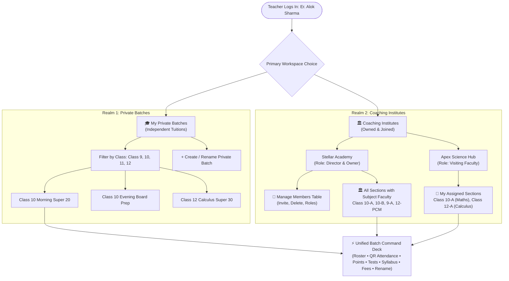

# Vilarci Study Partner — Teacher & Coaching Institute Portal
## Technical Pipeline, System Architecture & Database Design Specification

**Document Identifier**: `vilarci-study-partner-website-pipeline.md`  
**Application**: Vilarci Study Partner (Educator & Coaching Ecosystem v2.0)  
**Target Repository**: `Krishnendu-Kar/vilarci-study-partner-website`  
**Date of Specification**: October 2026  
**Architecture Paradigm**: Teacher-First Workspace with Dual Operational Realms (Private Tuitions vs Coaching Institutes)  

---

## 1. Executive Product Vision & Core Architecture

### 1.1 Who Logs In: The Individual Educator
In Vilarci Study Partner, the authenticated user is an **Educator / Teacher** (e.g., *Er. Alok Sharma*, *Dr. Rashmi Verma*, or *Prof. Arindam Sen*).
The portal is designed around the authentic mental model and daily workflow of Indian tutors and coaching faculty:
1. **Realm 1: "My Private Batches" (Independent Tuitions)**:
   - The teacher runs their own independent private tuition classes.
   - A single teacher teaches across multiple classes/grades (e.g., Class 9, Class 10, Class 11, Class 12).
   - In any given class, the teacher operates **multiple batches** (e.g., for Class 10: *Morning Super 20*, *Evening Board Prep*, *Sunday Olympiad Problem Solving*).
   - The teacher can create, name, and rename their own batches.
   - Entering any batch opens the **Batch Command Deck** to manage student performance, QR attendance, points dispensing, test marks, curriculum revision, and tuition fee dues.
2. **Realm 2: "Coaching Institutes" (Ownership & Memberships)**:
   - A teacher can **create their own Coaching Institute** (e.g., Er. Alok Sharma founded *Stellar Academy*):
     - In institutes they own or direct, they have administrative control over the **Members (Teachers) Table**: inviting teachers, assigning roles/permissions, allocating subjects, or deleting/removing faculty members.
   - A teacher can also be **joined in multiple coaching institutes** (e.g., Er. Alok Sharma is also joined as a Visiting Mathematics Faculty at *Apex Science Hub*).
   - When entering a coaching institute, the teacher sees **Classes with Sections** (e.g., `Class 10-A`, `Class 10-B`, `Class 9-A`, `Class 12-PCM-A`):
     - In coaching institutes, classes are divided into sections, and multiple teachers instruct different subjects in the same section (e.g., in `Class 10-A`: Maths with Alok Sharma, Physics with Meenakshi Soni, Chemistry with Rashmi Verma).
     - Clicking on a specific section opens the Section Command Deck to manage students, marks, attendance, and honors.



---

## 2. The Unified Batch Command Deck

Whether a teacher enters one of their **own private batches** or a **coaching section (`Class 10-A`)**, the workspace presents a unified, focused, distraction-free command deck:

1. **👥 Students Roster**:
   - Master directory of enrolled students (matching profiles from the Vilarci Study Student Portal: *Aryan Mehta*, *Rahul Sharma*, *Vivek Gupta*, *Tanvi Desai*, etc.).
   - Displays student roll numbers, learning points, study streaks, attendance %, and fee status.
   - Parent / Guardian contact records: **Father's Name & Verified Phone** (with one-click WhatsApp message link), **Mother's Phone**, and **Guardian Phone**.
   - **`+ Add Student to Batch` Modal & Dual Enrollment Engine**:
     - **Mechanism A (Automated Invite Link & QR)**: Every batch generates a deterministic unique invite link (`https://study.vilarci.in/join?batch=<batch_id>&code=<code_hash>`) and QR code. Students scanning or clicking join are immediately admitted into the batch with parent verified contacts. Includes an interactive demo simulation runner (`Simulate Student Joining via Invite Link`).
     - **Mechanism B (Manual Direct Registration)**: Teachers can directly onboard students, auto-suggesting roll numbers (`SA-110`), capturing OTP-verified Father & Mother contacts, initial fee status, and welcoming them with milestone points.
2. **📋 Daily Attendance & QR Terminal**:
   - **Live Rotating QR Code**: Projected on screen/tablet. Students scan via their mobile portal to claim **+10 learning points**.
   - **Rapid Attendance Roster**: One-click toggles: `Present [P]`, `Late [L]`, `Absent [A]`, plus `✓ Mark All Present`.
   - Generates automated WhatsApp/SMS notifications with prefilled attendance status.
3. **🏅 Points & Academic Honors Dispenser Desk**:
   - Teachers award faculty points (+50, +100, +150, +200) with custom citations.
   - **Live Batch Point Leaderboard**: Real-time peer standings re-ranking immediately upon point dispatch (e.g., Aryan Mehta climbing from Rank #3 to Rank #2).
4. **📝 Tests, Assessments & Scorecards**:
   - Schedule chapter tests, enter student marks, calculate class averages, and tag diagnostic weak topics.
5. **📖 Curriculum & Syllabus Tracker**:
   - Topic status toggles: `Covered`, `In Progress`, `Upcoming`.
   - Tracks how many students marked revision on their student portal (+15 pts).
6. **💳 Tuition Fees & Stamped Receipts**:
   - Monthly tuition fee ledger, offline payment recording, and printable stamped receipt vouchers with director signatures.
7. **⚙️ Batch Configuration (Rename)**:
   - Change batch name, schedule, monthly fee, or classroom suite.

---

## 3. Technology Stack & Client Architecture

```
┌────────────────────────────────────────────────────────────────────────┐
│                   VILARCI STUDY PARTNER ARCHITECTURE                   │
├────────────────────────────────────────────────────────────────────────┤
│  Presentation Layer:                                                   │
│    • Semantic HTML5: Contextual Views + Accessible Modals + Print CSS │
│    • CSS3 Design System: Custom Property Tokens, Dark Mode             │
│    • Regal Maroon Palette: #800020 (Primary), #D97706 (Amber Gold)     │
├────────────────────────────────────────────────────────────────────────┤
│  Application Logic Layer:                                              │
│    • Vanilla JavaScript ES5/ES6: Zero dependencies, zero build step   │
│    • Teacher Identity Engine: Multi-profile switching for testing     │
│    • Dual Realm Dispatcher: Private Tuitions vs Coaching Management    │
│    • Live Leaderboard Re-ranking Math: Real-time peer gap calculations │
│    • Pure SVG Vector QR Terminal: Scalable matrix generator           │
├────────────────────────────────────────────────────────────────────────┤
│  Data & Mock Persistence Layer:                                        │
│    • Normalized Relational Mock Store: window.TEACHER_PORTAL_DATA      │
│    • Persistence Engine: localStorage ('vilarci_teacher_state_v2')    │
└────────────────────────────────────────────────────────────────────────┘
```

- **Zero-Dependency Philosophy**: Pure HTML5, CSS3, and modern Vanilla JavaScript. Works natively over `file://` or local static servers.
- **Sub-50ms Initial Render**: No framework hydration overhead or layout shifts.

---

## 4. Production Database Design (PostgreSQL 16+ DDL)

```sql
-- =============================================================================
-- VILARCI STUDY PARTNER PRODUCTION DATABASE SCHEMA (POSTGRESQL 16+)
-- =============================================================================

CREATE EXTENSION IF NOT EXISTS "uuid-ossp";
CREATE EXTENSION IF NOT EXISTS "pgcrypto";

-- 1. TEACHERS & EDUCATORS (Primary Accounts)
CREATE TABLE teachers (
    id UUID PRIMARY KEY DEFAULT gen_random_uuid(),
    full_name VARCHAR(150) NOT NULL,
    email VARCHAR(255) UNIQUE NOT NULL,
    phone VARCHAR(30) UNIQUE NOT NULL,
    password_hash VARCHAR(255) NOT NULL,
    qualification VARCHAR(200) NOT NULL,
    primary_subject VARCHAR(100) NOT NULL,
    photo_initials VARCHAR(4) NOT NULL,
    avatar_bg VARCHAR(50) DEFAULT '#800020',
    created_at TIMESTAMPTZ DEFAULT CURRENT_TIMESTAMP
);

-- 2. PRIVATE BATCHES (Tutor's Own Independent Classes)
CREATE TABLE private_batches (
    id UUID PRIMARY KEY DEFAULT gen_random_uuid(),
    teacher_id UUID NOT NULL REFERENCES teachers(id) ON DELETE CASCADE,
    batch_name VARCHAR(150) NOT NULL, -- e.g. 'Class 10 Maths Morning Super 20'
    grade_level VARCHAR(20) NOT NULL, -- 'Class 10', 'Class 12'
    academic_board VARCHAR(50) NOT NULL, -- 'CBSE', 'ICSE'
    subject VARCHAR(100) NOT NULL,
    schedule_text VARCHAR(255) NOT NULL,
    classroom_room VARCHAR(100) NOT NULL,
    monthly_fee_inr NUMERIC(10, 2) NOT NULL DEFAULT 0.00,
    max_capacity INTEGER NOT NULL DEFAULT 20,
    created_at TIMESTAMPTZ DEFAULT CURRENT_TIMESTAMP
);

-- 3. COACHING INSTITUTES
CREATE TABLE coaching_institutes (
    id UUID PRIMARY KEY DEFAULT gen_random_uuid(),
    owner_teacher_id UUID NOT NULL REFERENCES teachers(id),
    name VARCHAR(200) NOT NULL,
    tagline TEXT,
    invite_code VARCHAR(10) UNIQUE NOT NULL, -- e.g. 'STLR10', 'APEX99'
    logo_text VARCHAR(10) NOT NULL,
    theme_color VARCHAR(20) DEFAULT '#800020',
    address TEXT NOT NULL,
    phone VARCHAR(30) NOT NULL,
    email VARCHAR(255) NOT NULL,
    bank_upi VARCHAR(100),
    established_year INTEGER,
    created_at TIMESTAMPTZ DEFAULT CURRENT_TIMESTAMP
);

-- 4. COACHING MEMBERS (Teachers connected to an institute)
CREATE TABLE coaching_members (
    id UUID PRIMARY KEY DEFAULT gen_random_uuid(),
    institute_id UUID NOT NULL REFERENCES coaching_institutes(id) ON DELETE CASCADE,
    teacher_id UUID NOT NULL REFERENCES teachers(id) ON DELETE CASCADE,
    role_title VARCHAR(150) NOT NULL, -- 'Director', 'Senior Faculty', 'Visiting Faculty'
    permission_level VARCHAR(50) NOT NULL DEFAULT 'Subject Faculty' 
        CHECK (permission_level IN ('Owner / Full Admin', 'Co-Admin', 'Subject Faculty', 'Lab Mentor')),
    joined_date DATE NOT NULL DEFAULT CURRENT_DATE,
    CONSTRAINT uq_coaching_teacher UNIQUE (institute_id, teacher_id)
);

-- 5. COACHING CLASSES & SECTIONS (e.g. Class 10-A, Class 10-B)
CREATE TABLE coaching_sections (
    id UUID PRIMARY KEY DEFAULT gen_random_uuid(),
    institute_id UUID NOT NULL REFERENCES coaching_institutes(id) ON DELETE CASCADE,
    class_name VARCHAR(50) NOT NULL, -- 'Class 10', 'Class 9'
    section_name VARCHAR(50) NOT NULL, -- 'Section A', 'Section B'
    full_code VARCHAR(100) NOT NULL, -- 'Class 10-A'
    board VARCHAR(50) NOT NULL,
    room_number VARCHAR(100) NOT NULL,
    max_capacity INTEGER NOT NULL DEFAULT 35,
    created_at TIMESTAMPTZ DEFAULT CURRENT_TIMESTAMP
);

-- 6. SECTION SUBJECT-FACULTY ASSIGNMENTS (Multi-Teacher Mapping)
CREATE TABLE section_faculty_assignments (
    id UUID PRIMARY KEY DEFAULT gen_random_uuid(),
    section_id UUID NOT NULL REFERENCES coaching_sections(id) ON DELETE CASCADE,
    teacher_id UUID NOT NULL REFERENCES teachers(id) ON DELETE CASCADE,
    subject VARCHAR(100) NOT NULL, -- e.g. 'Mathematics', 'Physics'
    lectures_per_week INTEGER NOT NULL DEFAULT 3,
    schedule_text VARCHAR(255),
    CONSTRAINT uq_sec_teacher_subj UNIQUE (section_id, teacher_id, subject)
);

-- 7. STUDENTS & ENROLLMENTS
CREATE TABLE students (
    id UUID PRIMARY KEY DEFAULT gen_random_uuid(),
    full_name VARCHAR(150) NOT NULL,
    roll_number VARCHAR(50) NOT NULL,
    grade_level VARCHAR(20) NOT NULL,
    academic_board VARCHAR(50) NOT NULL,
    student_phone VARCHAR(20),
    father_name VARCHAR(150) NOT NULL,
    father_phone VARCHAR(20) NOT NULL,
    father_phone_verified BOOLEAN DEFAULT TRUE,
    mother_name VARCHAR(150) NOT NULL,
    mother_phone VARCHAR(20) NOT NULL,
    mother_phone_verified BOOLEAN DEFAULT TRUE,
    guardian_name VARCHAR(150),
    guardian_phone VARCHAR(20),
    learning_points INTEGER DEFAULT 0 CHECK (learning_points >= 0),
    study_streak_days INTEGER DEFAULT 0,
    created_at TIMESTAMPTZ DEFAULT CURRENT_TIMESTAMP
);

-- Polymorphic Enrollments (Student in private batch OR coaching section)
CREATE TABLE batch_enrollments (
    id UUID PRIMARY KEY DEFAULT gen_random_uuid(),
    student_id UUID NOT NULL REFERENCES students(id) ON DELETE CASCADE,
    private_batch_id UUID REFERENCES private_batches(id) ON DELETE CASCADE,
    coaching_section_id UUID REFERENCES coaching_sections(id) ON DELETE CASCADE,
    enrolled_at DATE NOT NULL DEFAULT CURRENT_DATE,
    CHECK (
        (private_batch_id IS NOT NULL AND coaching_section_id IS NULL) OR
        (private_batch_id IS NULL AND coaching_section_id IS NOT NULL)
    )
);

-- 8. ATTENDANCE SESSIONS & DAILY ENTRIES
CREATE TABLE attendance_sessions (
    id UUID PRIMARY KEY DEFAULT gen_random_uuid(),
    private_batch_id UUID REFERENCES private_batches(id) ON DELETE CASCADE,
    coaching_section_id UUID REFERENCES coaching_sections(id) ON DELETE CASCADE,
    session_date DATE NOT NULL DEFAULT CURRENT_DATE,
    conducting_teacher_id UUID NOT NULL REFERENCES teachers(id),
    qr_token_hash VARCHAR(255) NOT NULL,
    created_at TIMESTAMPTZ DEFAULT CURRENT_TIMESTAMP
);

CREATE TABLE attendance_entries (
    id UUID PRIMARY KEY DEFAULT gen_random_uuid(),
    session_id UUID NOT NULL REFERENCES attendance_sessions(id) ON DELETE CASCADE,
    student_id UUID NOT NULL REFERENCES students(id) ON DELETE CASCADE,
    status VARCHAR(20) NOT NULL CHECK (status IN ('present', 'absent', 'late', 'excused')),
    check_in_time TIME,
    points_awarded INTEGER DEFAULT 0
);

-- 9. POINTS DISPATCHES (ACADEMIC HONORS LEDGER)
CREATE TABLE points_dispatches (
    id UUID PRIMARY KEY DEFAULT gen_random_uuid(),
    teacher_id UUID NOT NULL REFERENCES teachers(id),
    student_id UUID NOT NULL REFERENCES students(id) ON DELETE CASCADE,
    private_batch_id UUID REFERENCES private_batches(id),
    coaching_section_id UUID REFERENCES coaching_sections(id),
    points_amount INTEGER NOT NULL CHECK (points_amount > 0),
    category VARCHAR(100) NOT NULL,
    citation_reason TEXT NOT NULL,
    awarded_date DATE NOT NULL DEFAULT CURRENT_DATE,
    created_at TIMESTAMPTZ DEFAULT CURRENT_TIMESTAMP
);

-- =============================================================================
-- ROW LEVEL SECURITY (RLS) POLICIES
-- =============================================================================
ALTER TABLE private_batches ENABLE ROW LEVEL SECURITY;
ALTER TABLE coaching_institutes ENABLE ROW LEVEL SECURITY;
ALTER TABLE coaching_members ENABLE ROW LEVEL SECURITY;
ALTER TABLE points_dispatches ENABLE ROW LEVEL SECURITY;

-- Private Batch Policy: Teachers can only view/edit their own private batches
CREATE POLICY teacher_private_batches ON private_batches
    FOR ALL
    USING (teacher_id = auth.uid());

-- Coaching Members Policy: Only institute owner can invite/delete members
CREATE POLICY coaching_owner_manage_members ON coaching_members
    FOR ALL
    USING (institute_id IN (
        SELECT id FROM coaching_institutes WHERE owner_teacher_id = auth.uid()
    ));

-- Points Awarding Policy: Teachers can award points to any student in their batch/section
CREATE POLICY teacher_award_points ON points_dispatches
    FOR INSERT
    WITH CHECK (teacher_id = auth.uid());
```

---

## 5. Deployment, DevOps & CI/CD Pipeline ("Partner Pipeline")

### 5.1 Dual-Account GitHub Configuration
- **Repository**: `git@github-krishnenedu:Krishnendu-Kar/vilarci-study-partner-website.git`
- **SSH Host Alias**: `github-krishnenedu`
- **Committer Identity**: `Krishnendu-Kar` (`sukrish14369@gmail.com`)

### 5.2 Automated CI/CD Workflow (GitHub Actions)
```yaml
name: Vilarci Study Partner Pipeline

on:
  push:
    branches: [ main ]
  pull_request:
    branches: [ main ]

jobs:
  validate-and-deploy:
    runs-on: ubuntu-latest
    steps:
      - name: Checkout Code
        uses: actions/checkout@v4

      - name: Setup Node.js
        uses: actions/setup-node@v4
        with:
          node-version: 20

      - name: Validate JavaScript Syntax
        run: |
          node -c Vilarci-study-partner-demo/Antigravity/js/data.js
          node -c Vilarci-study-partner-demo/Antigravity/js/main.js

      - name: Deploy to Cloudflare Pages
        if: github.ref == 'refs/heads/main'
        uses: cloudflare/wrangler-action@v3
        with:
          apiToken: ${{ secrets.CLOUDFLARE_API_TOKEN }}
          accountId: ${{ secrets.CLOUDFLARE_ACCOUNT_ID }}
          command: pages deploy Vilarci-study-partner-demo/Antigravity --project-name=vilarci-study-partner
```

---

*This document serves as the canonical technical pipeline and architectural blueprint for Vilarci Study Partner.*
